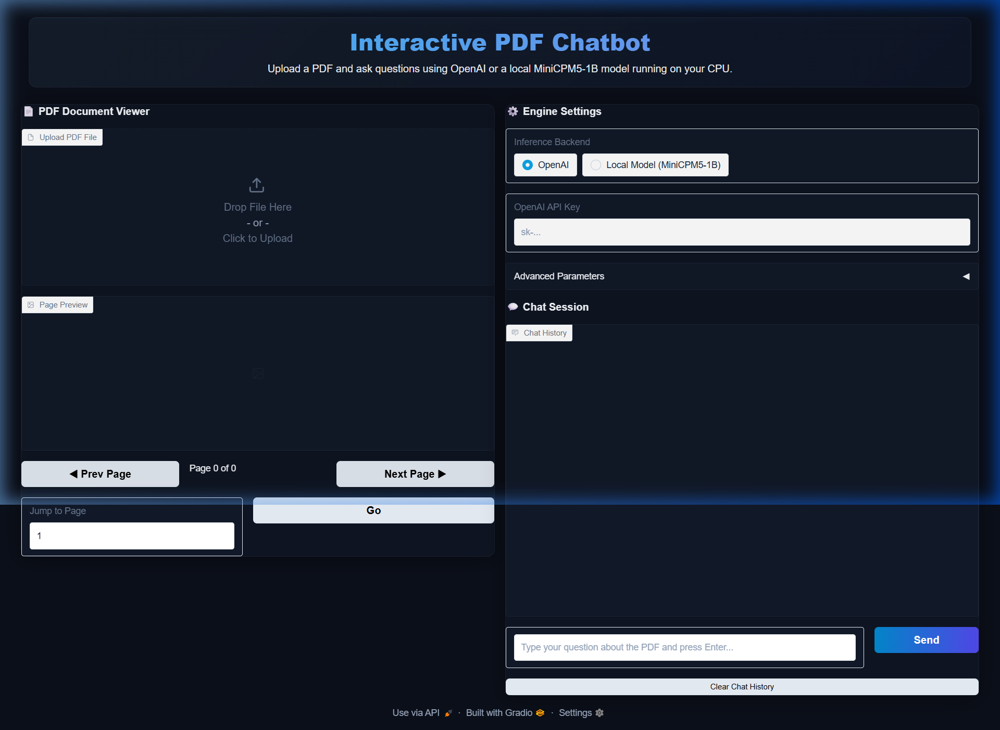
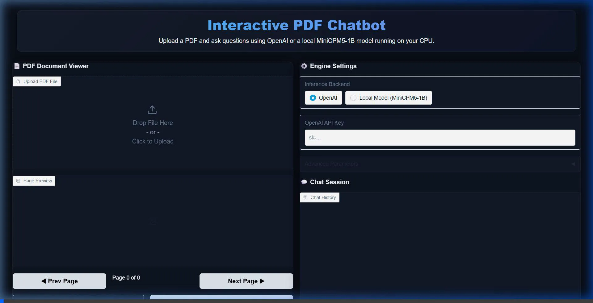
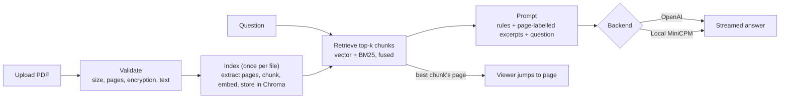

# PDF Chatbot

[](https://github.com/tc043/pdf_chatbot/actions/workflows/ci.yml)

Upload a PDF and ask questions about it. The app retrieves the most relevant passages
(retrieval-augmented generation, RAG) and has a language model answer from them, citing
page numbers. You can use either:

1. **OpenAI** (default `gpt-4o-mini`, needs an API key), or
2. a **local MiniCPM5-1B-SFT** model on your CPU/GPU with local embeddings
   (`all-MiniLM-L6-v2`), which needs no API key or network after the initial download.

Vectors are stored locally in [Chroma](https://www.trychroma.com/); the UI is built with
[Gradio](https://www.gradio.app/).

## UI Preview

[](assets/demo_screenshot.png)

*Interaction demonstration:* [](assets/demo_recording.webp)

## Features

- **Two backends**, switchable in the UI: OpenAI chat models or the local MiniCPM5-1B-SFT
  (with its Think / No-Think reasoning toggle).
- **Follow-up questions**: the last few turns are remembered, so "what about its cost?" works.
- **Scanned PDFs** (optional): pages that are only pictures of text are read with
  [Tesseract](https://github.com/tesseract-ocr/tesseract) OCR when it is installed.
- **Page-aware answers**: excerpts are labelled with page numbers, the model is asked to cite
  them, and the page viewer jumps to the best-matching page.
- **Interactive page viewer** with previous/next and jump-to-page.
- **Persistent index**: a PDF is embedded once; later questions (and restarts) reuse it. The
  index is keyed by the file's *content*, so two different files with the same name never
  collide and an edited file is re-indexed.
- **Input and resource limits**: file size, page count, question length, request timeouts,
  retries, and a bounded request queue (all configurable).
- **Clear errors**: password-protected, corrupt, non-PDF and unreadable scanned files are
  rejected with an explanation; provider problems (bad key, rate limit, timeout) are reported
  in plain language and details go to the server log, not the browser.
- **Demo PDFs** in `demo_pdfs/` for quick testing: *Attention Is All You Need* and the GPT-3
  paper.

## Quick start

Requires Python 3.10 – 3.13.

```bash
python3 -m venv .venv
source .venv/bin/activate            # Windows: .venv\Scripts\activate
pip install -r requirements.txt      # app + OpenAI backend
python run.py                        # or ./start.sh / start.bat
```

Open the printed URL (default <http://127.0.0.1:7860>), upload a PDF, paste your OpenAI key
into the settings panel (or set `OPENAI_API_KEY` on the server, see
[Security](#security-and-privacy)), and ask a question.

### Local model (optional)

```bash
pip install -r requirements.txt -r requirements-local.txt
```

On a machine without a GPU, install the much smaller CPU build of PyTorch first:
`pip install torch --index-url https://download.pytorch.org/whl/cpu`.
The first local question downloads the model weights (about 2 GB) and embedding model.
If the optional packages are missing, the UI tells you which command to run.

### Scanned PDFs / OCR (optional)

Pages with no text layer but with an image are read with OCR if the Tesseract program is
installed (for example `sudo apt install tesseract-ocr`, `brew install tesseract`, or the
Windows installer) together with the language data you need. Without it, a scanned PDF is
rejected with a message that says so. Pages with a normal text layer are never OCR'd. OCR is
slow (roughly a second or less per page) and runs while the PDF is indexed, so the number of
OCR'd pages is limited (`PDFCHAT_OCR_MAX_PAGES`); a PDF above the limit is rejected with a
message naming it. Switch OCR off with `PDFCHAT_OCR=off`. Turning OCR on rebuilds the index of
documents that were indexed without it.

#### Remote OCR server (optional, experimental)

Instead of Tesseract, scanned pages can be read by a vision model that you run yourself behind
an OpenAI-compatible API, for example
[`baidu/Unlimited-OCR`](https://huggingface.co/baidu/Unlimited-OCR) on vLLM (it needs an
NVIDIA GPU and its own `vllm/vllm-openai:unlimited-ocr` image; see the
[vLLM recipe](https://recipes.vllm.ai/baidu/Unlimited-OCR)). It is much better than Tesseract
at tables, formulas and reading order, according to its authors' benchmarks. Enable it with:

```bash
PDFCHAT_OCR_ENGINE=remote
PDFCHAT_OCR_REMOTE_URL=http://gpu-box:8000/v1
# PDFCHAT_OCR_REMOTE_MODEL=baidu/Unlimited-OCR   PDFCHAT_OCR_REMOTE_API_KEY=...
```

Each scanned page is sent as one PNG image, so **page images leave this machine** (the chat
shows a note while indexing). Use only a server you trust; the URL can only be set through the
environment, never in the browser. Indexes made with the remote engine are kept separate from
Tesseract ones. The request format follows the vLLM recipe, but **this has not been tested
against a live server** from this repository, and other servers may need a different prompt or
extra parameters (see `app/ocr_remote.py`).

### Docker

```bash
docker compose up --build            # OpenAI backend, http://127.0.0.1:7860
```

Set `WITH_LOCAL_MODEL: "true"` under `build.args` in `docker-compose.yml` to bundle PyTorch
for the local backend (several GB), and `WITH_OCR: "true"` to install Tesseract (English) for
scanned PDFs (about 100 MB). The container runs as a non-root user, keeps all state in
the `/data` volume, and does not use the server's `OPENAI_API_KEY` unless you opt in with
`PDFCHAT_USE_SERVER_KEY=true`.

## Configuration

All settings are optional environment variables (see [`.env.example`](.env.example)).
Invalid values stop the app at startup with a message naming the variable.

| Variable | Default | Meaning |
| --- | --- | --- |
| `OPENAI_API_KEY` | – | Server-side fallback key (only used if `PDFCHAT_USE_SERVER_KEY` is true; never sent to browsers) |
| `PDFCHAT_USE_SERVER_KEY` | `true` (`false` in the Docker image) | Let users who leave the key box empty use `OPENAI_API_KEY` |
| `PDFCHAT_HOST` / `PDFCHAT_PORT` | `127.0.0.1` / `7860` | Listen address. Use `0.0.0.0` only with authentication |
| `PDFCHAT_AUTH_USER` / `PDFCHAT_AUTH_PASSWORD` | – | Enable HTTP basic auth (set both or neither) |
| `PDFCHAT_OPENAI_MODEL` | `gpt-4o-mini` | Chat model |
| `PDFCHAT_OPENAI_EMBEDDING_MODEL` | `text-embedding-3-small` | Embedding model for the OpenAI backend |
| `PDFCHAT_LOCAL_MODEL` | `openbmb/MiniCPM5-1B-SFT` | Hugging Face id of the local chat model |
| `PDFCHAT_LOCAL_EMBEDDING_MODEL` | `sentence-transformers/all-MiniLM-L6-v2` | Embedding model for the local backend |
| `PDFCHAT_CHUNK_SIZE` / `PDFCHAT_CHUNK_OVERLAP` | `1000` / `200` | Chunking (characters) |
| `PDFCHAT_RETRIEVER_K` | `3` | Chunks passed to the model |
| `PDFCHAT_INDEX_MAX_COUNT` / `PDFCHAT_INDEX_MAX_AGE_DAYS` | `0` / `0` | Optional retention: keep indexes for at most this many PDFs / delete indexes unused this long (`0` = keep everything). The PDF in use is never removed |
| `PDFCHAT_HISTORY_TURNS` | `3` | Earlier question/answer pairs given to the model for follow-ups (`0` turns memory off) |
| `PDFCHAT_RETRIEVAL_MODE` | `hybrid` | `hybrid` merges vector search with BM25 keyword search; `vector` uses embeddings only |
| `PDFCHAT_CHROMA_DIR` | `./.chromadb` | Where the vector index is stored |
| `PDFCHAT_MAX_PDF_MB` / `PDFCHAT_MAX_PDF_PAGES` | `25` / `300` | Upload limits |
| `PDFCHAT_OCR` / `PDFCHAT_OCR_LANGUAGE` / `PDFCHAT_OCR_MAX_PAGES` | `auto` / `eng` / `50` | OCR for scanned pages: `auto` (when Tesseract is installed) or `off`; Tesseract language codes such as `eng+deu`; maximum pages to OCR per PDF |
| `PDFCHAT_OCR_ENGINE` / `PDFCHAT_OCR_REMOTE_URL` | `tesseract` / empty | OCR engine: `tesseract`, or `remote` to send scanned pages to your own OpenAI-compatible vision server at that URL (see [Remote OCR server](#remote-ocr-server-optional-experimental)) |
| `PDFCHAT_OCR_REMOTE_MODEL` / `PDFCHAT_OCR_REMOTE_API_KEY` / `PDFCHAT_OCR_REMOTE_TIMEOUT_S` | `baidu/Unlimited-OCR` / empty / `120` | Model name, optional API key and per-page timeout for the remote engine |
| `PDFCHAT_MAX_QUESTION_CHARS` | `2000` | Question length limit |
| `PDFCHAT_OPENAI_TIMEOUT_S` / `PDFCHAT_OPENAI_MAX_RETRIES` | `60` / `2` | OpenAI request behaviour |
| `PDFCHAT_LOCAL_TOKEN_TIMEOUT_S` | `120` | Abort a local generation that stalls this long; also how long a request waits for a busy local model before failing with a "busy" error |
| `PDFCHAT_MAX_CONCURRENT_REQUESTS` / `PDFCHAT_QUEUE_MAX_SIZE` | `2` / `20` | Gradio concurrency and queue bound |
| `PDFCHAT_LOG_LEVEL` | `INFO` | Python logging level |

Changing the embedding model or chunk settings automatically uses a fresh index instead of
mixing incompatible vectors.

## How it works



```
pdf_chatbot/
├── app/
│   ├── config.py          # Settings from environment variables (validated, no import side effects)
│   ├── exceptions.py      # Errors whose messages are safe to show to users
│   ├── logging_config.py  # Logging with API-key redaction
│   ├── index_store.py     # List, delete and prune stored indexes (also a small CLI)
│   ├── pdf_engine.py      # Validation, rendering, extraction, chunking, Chroma indexing
│   ├── llm_engine.py      # Prompt construction, OpenAI and local streaming
│   ├── chat.py            # One question/answer turn (validate -> index -> retrieve -> generate)
│   └── ui.py              # Gradio interface (thin: forwards to chat.py)
├── tests/                 # pytest suite
├── run.py                 # Entry point
├── Dockerfile, docker-compose.yml
└── .github/workflows/ci.yml
```

## Managing stored indexes

Each indexed PDF leaves a vector index and an Open Knowledge Format bundle in
`PDFCHAT_CHROMA_DIR`. They are reused for later questions and restarts, and are rebuilt on
demand if deleted. The UI has a **Delete this PDF's stored index** button for the PDF that is
open. Operators can inspect and clean up everything from the command line (inside Docker:
`docker compose exec pdf-chatbot python -m app.index_store list`):

```bash
python -m app.index_store list
python -m app.index_store delete <fingerprint-prefix>      # from the 'list' output
python -m app.index_store prune --older-than-days 30 --keep 20
python -m app.index_store clear --yes
```

Set `PDFCHAT_INDEX_MAX_COUNT` and/or `PDFCHAT_INDEX_MAX_AGE_DAYS` to prune automatically
after each question. Both are off by default, so nothing is deleted unless you ask for it.
"Last used" is the time an index was built or last reused.

## Security and privacy

- **API keys.** A key typed into the UI is used for that request only: it is not stored, not
  logged (log output redacts `sk-…` tokens) and not placed in process-wide environment
  variables. The server's `OPENAI_API_KEY` is never sent to the browser. Keys travel from the
  browser to the server, so serve the app over HTTPS (for example behind a reverse proxy) if
  it is not on `localhost`.
- **Binding and auth.** The server listens on `127.0.0.1` by default. If you set
  `PDFCHAT_HOST=0.0.0.0`, enable `PDFCHAT_AUTH_USER`/`PDFCHAT_AUTH_PASSWORD` (or use an
  authenticating proxy) and set `PDFCHAT_USE_SERVER_KEY=false`, otherwise anyone who can reach
  the port can use your model and your OpenAI credit; the app logs a warning at startup if so.
  Hiding Gradio's "Use via API" link is cosmetic: authentication is the access control.
- **Your documents.** With the OpenAI backend, the question, the retrieved excerpts and the
  last few turns of the chat are sent to OpenAI (and, for indexing, the document text is sent
  to the embeddings API). With the local backend nothing leaves your machine after the model
  download. Extracted text and embeddings are stored unencrypted in `PDFCHAT_CHROMA_DIR`;
  delete that directory, or see [Managing stored indexes](#managing-stored-indexes), to
  remove them. There is no per-user isolation, and by default nothing is deleted
  automatically.
- **Remote OCR.** Off by default. With `PDFCHAT_OCR_ENGINE=remote`, an image of every scanned
  page is sent to the server you configured, over whatever transport its URL uses (prefer
  `https://`). The server's API key is never shown in logs or the UI.
- **Telemetry.** Gradio and Chroma usage telemetry are disabled.
- **Prompt injection.** Excerpts are placed in delimited blocks, tag look-alikes inside them are
  stripped, and the model is told to treat them as untrusted data. This reduces, but cannot
  eliminate, the risk that text inside a malicious PDF steers the answer.

## Limitations

- Conversation memory is short: only the last few turns (default 3) are remembered, follow-up
  questions are resolved by also searching with the previous question, and uploading a new PDF
  clears the chat. Memory is not stored on the server.
- Scanned (image-only) pages are read with OCR only when Tesseract is installed, and OCR
  accuracy depends on the scan (no table structure, no handwriting). Tables and multi-column
  layouts in text PDFs are extracted as plain text and can come out in a confusing order.
- Retrieval is vector search merged with BM25 keyword search (no re-ranking). Answer quality
  depends on the chosen model, and small local models hallucinate more than hosted ones. The
  repository only evaluates retrieval (see Development), not the quality of generated answers,
  and the quick check is small (21 questions on the two demo PDFs); see
  [docs/benchmark.md](docs/benchmark.md) for the larger benchmark on public papers.
- Index builds are serialised in one process, and indexes are kept until you delete them
  (see [Managing stored indexes](#managing-stored-indexes)) or enable a retention limit. The app is designed for a single server process and a small number of users.
- Gradio is pinned to the 5.x line; the UI uses APIs that Gradio 6 removed.
- The local backend on CPU is slow, especially with reasoning mode on.

## Development

```bash
pip install -r requirements-dev.txt
ruff check . && ruff format --check .
pytest --cov
```

- The unit tests are offline and fast: embeddings and chat models are replaced by fakes.
- `tests/test_local_model_integration.py` exercises the real `transformers` streaming and
  cancellation code with a tiny random-weights model (no downloads). It runs automatically when
  `torch` and `transformers` are installed (`pip install -r requirements-local.txt`) and skips
  otherwise.
- `python -m evals.retrieval_eval` compares vector, BM25 and hybrid retrieval on 21 labelled
  questions about the demo PDFs (needs `requirements-local.txt`; the first run downloads the
  embedding model). Gold pages are found by locating an evidence phrase in the PDF text. On
  the current set, hybrid beats vector-only at `k=3` and `k=5`, e.g. at `k=3` the hit rate is
  86% against 62% overall. BM25 alone scores as well or better here because the questions
  reuse the document's wording, so treat the result as a regression check, not a benchmark.
  It is not run in CI because it downloads a model.
- `python -m evals.qasper_benchmark` is the real retrieval benchmark: questions written by other
  people about real arXiv papers (Qasper, CC BY 4.0), with confidence intervals and chunk-size
  comparisons. See [docs/benchmark.md](docs/benchmark.md) for the method, how to run it and the
  results. On the 1270 test questions hybrid retrieval is at least as good as vector-only
  (page hit@3 73.6% against 72.2%, a difference within noise at the default chunk size), and
  500-character chunks with `k=6` find the evidence page more often than 1000 with `k=3`
  (86.6% against 73.6%) at the same amount of text; that is a recommendation, not yet the
  default. With the local model, answers from the small-chunk setting scored no worse than the
  default (Answer-F1 0.309 against 0.297, difference within noise). It downloads data, so it is
  not run in CI.
- CI (GitHub Actions) runs lint, the tests on several Python versions, the local-model tests,
  a real-Tesseract OCR test (`pytest -m ocr`), and builds and smoke-tests the Docker image
  (without the optional OCR and local-model extras).

## Upgrading from earlier versions

- `requirements.txt` now covers the OpenAI backend only; add `requirements-local.txt` for the
  local model. Dependencies have upper bounds (a fresh install of the old unpinned file pulled
  in Gradio 6, which crashes this UI at startup).
- The server listens on `127.0.0.1` by default (it used to listen on `0.0.0.0`). Set
  `PDFCHAT_HOST=0.0.0.0` for network access.
- The OpenAI key box is no longer pre-filled from `OPENAI_API_KEY`; the server key is used as a
  silent fallback instead (see `PDFCHAT_USE_SERVER_KEY`).
- Scanned PDFs are accepted when Tesseract is installed (see OCR above); set `PDFCHAT_OCR=off`
  for the previous behaviour.
- Stored indexes can now be deleted from the UI or `python -m app.index_store`, and optional
  retention limits exist (off by default).
- Chat now remembers the last few turns (`PDFCHAT_HISTORY_TURNS`, `0` to disable) and
  uploading or removing a PDF clears the chat.
- Retrieval is now hybrid (vector + BM25) by default. Set `PDFCHAT_RETRIEVAL_MODE=vector` for
  the previous embeddings-only behaviour; existing indexes keep working.
- Indexes are named differently, so an existing `.chromadb/` is not reused. It is safe to delete.
